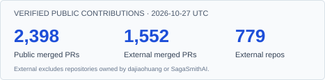

<strong>🌐 English — click to expand</strong>

Software Engineer Intern @ TikTok · MSc DSML @ NUS · SJTU alumnus

Working on agent systems and scientific visualization.

### Selected projects

- [**SagaSmith**](https://sagasmithai.github.io/): Agent-led TTRPG platform with a rules engine (Alpha).
- [**RepoStew**](https://dajiaohuang.github.io/repostew/): Repository workflows and a Pi-native execution harness with native queues, durable continuation, and MCP/CLI governance; integrates with OpenRig.
- [**Clash of Tokens**](https://github.com/dajiaohuang/clash-of-tokens): Local Go AI gateway across providers and accounts.
- [**Archive & Apply**](https://dajiaohuang.github.io/Archive_and_Apply_Skill/): Traceable resumes, interview materials, and applications.
- [**Evo Atlas**](https://dajiaohuang.github.io/evo/): Geological time, fossils, and evolution with scientific uncertainty.
- [**Solar Atlas**](https://dajiaohuang.github.io/solar/): Orbits and small-body exploration; not for operational navigation.

### Selected contributions

- [MervinPraison/PraisonAI](https://github.com/MervinPraison/PraisonAI) — Agent runtime, tool calls, session and storage reliability fixes (**105 merged PRs**)
- [domokane/FinancePy](https://github.com/domokane/FinancePy) — Pricing stability, date handling, and cash-flow fixes (**57 merged PRs**)
- [doocs/leetcode](https://github.com/doocs/leetcode) — Algorithm boundaries, C++ overflow, and SQL / Pandas solution fixes (**20 merged PRs**)
- [domoticz/domoticz](https://github.com/domoticz/domoticz) — Device protocol, hardware concurrency, and resource management fixes (**38 merged PRs**)
- [mvschwarz/openrig](https://github.com/mvschwarz/openrig) — Session recovery, process lifecycle, and runtime isolation fixes (**30 merged PRs**)
- [affaan-m/ECC](https://github.com/affaan-m/ECC) — Command aliases, test isolation, and CI validation fixes (**4 merged PRs**)
- [public-apis/public-apis](https://github.com/public-apis/public-apis) — API entries and duplicate-link checker fixes (**3 merged PRs**)
- [HKUDS/nanobot](https://github.com/HKUDS/nanobot) — Windows execution, API authentication, and session archive fixes (**8 merged PRs**)
- [HKUDS/DeepTutor](https://github.com/HKUDS/DeepTutor) — Learning-state, MCP configuration, and WebUI save reliability fixes (**35 merged PRs**)
- [lateralblast/lunar](https://github.com/lateralblast/lunar) — System and cloud audit checks and CLI behavior fixes (**50 merged PRs**)
- [puppeteer/puppeteer](https://github.com/puppeteer/puppeteer) — Browser connection, temporary profile cleanup, and Windows build fixes (**6 merged PRs**)
- [revive-lint/revive](https://github.com/revive-lint/revive) — Rule configuration reset, syntax checks, and SARIF output fixes (**15 merged PRs**)
- [ruvnet/ruflo](https://github.com/ruvnet/ruflo) — Tool selection, Windows launch, and session state fixes (**8 merged PRs**)
- [tursodatabase/turso](https://github.com/tursodatabase/turso) — SQL alias, JSON NULL, and SQLite compatibility fixes (**9 merged PRs**)
- [bytedance/deer-flow](https://github.com/bytedance/deer-flow) — Windows sandbox execution fixes and extension documentation updates (**3 merged PRs**)
- [JustVugg/colibri](https://github.com/JustVugg/colibri) — Inference cancellation fixes and Windows test compatibility (**5 merged PRs**)
- [cheaper-inference/OmniRoute](https://github.com/cheaper-inference/OmniRoute) — Evaluation failure handling, request measurement, and multilingual detection fixes (**3 merged PRs**)
- [volcengine/OpenViking](https://github.com/volcengine/OpenViking) — Memory indexing, patch handling, and Windows Go SDK fixes (**4 merged PRs**)
- [TriliumNext/Trilium](https://github.com/TriliumNext/Trilium) — Desktop launch, OIDC logout, and saved-search execution fixes (**4 merged PRs**)
- [EbookFoundation/free-programming-books](https://github.com/EbookFoundation/free-programming-books) — Added React and Markdown learning resources (**2 merged PRs**)
- [revolist/revogrid](https://github.com/revolist/revogrid) — Sorting, column sizing, CSV export, and plugin cleanup fixes (**11 merged PRs**)
- [coreyhaines31/marketingskills](https://github.com/coreyhaines31/marketingskills) — Documentation link fixes and CLI catalog completion (**3 merged PRs**)
- [ChromeDevTools/chrome-devtools-mcp](https://github.com/ChromeDevTools/chrome-devtools-mcp) — Configuration coercion fixes, Windows tests, and routing documentation (**3 merged PRs**)
- [fmtlib/fmt](https://github.com/fmtlib/fmt) — Tuple formatting, documentation encoding, and format-reference fixes (**4 merged PRs**)
- [Egonex-AI/Understand-Anything](https://github.com/Egonex-AI/Understand-Anything) — File-read error reporting and Windows installation path fixes (**2 merged PRs**)
- [TheAlgorithms/Python](https://github.com/TheAlgorithms/Python) — Fixed integer precision in the trailing-zeroes algorithm (**1 merged PR**)
- [career-ops-hq/career-ops](https://github.com/career-ops-hq/career-ops) — Security policy scope and contribution documentation links (**2 merged PRs**)
- [Tencent/WeKnora](https://github.com/Tencent/WeKnora) — Shared knowledge-base scope, Windows docs launch, and style-check fixes (**3 merged PRs**)
- [anomalyco/opencode](https://github.com/anomalyco/opencode) — Corrected the plugin system documentation example (**1 merged PR**)
- [reviewdog/reviewdog](https://github.com/reviewdog/reviewdog) — Diagnostic retention, SARIF severity, and OAuth callback fixes (**5 merged PRs**)
- [huggingface/transformers](https://github.com/huggingface/transformers) — Fixed MiniMax M2 partial rotary parameter mapping (**1 merged PR**)
- [VisActor/VChart](https://github.com/VisActor/VChart) — Build failure propagation fixes and documentation link maintenance (**10 merged PRs**)
- [bytedance/g3](https://github.com/bytedance/g3) — Configuration parsing, cross-platform commands, and Rust CI fixes (**7 merged PRs**)
- [web-infra-dev/rspress](https://github.com/web-infra-dev/rspress) — Documentation link fixes and agent tool requirement updates (**6 merged PRs**)
- [bytedance/vArmor](https://github.com/bytedance/vArmor) — Policy immutability, concurrent registries, and port-range fixes (**7 merged PRs**)

As of 2026-10-27 (UTC): 6,964 public authored PRs (2,398 merged); 1,552 merged PRs across 779 public external repositories, excluding repositories owned by dajiaohuang or SagaSmithAI. <a href="./contributions.json">Snapshot</a>

### Research

- **CVPR 2024** — [Inter-X](https://arxiv.org/abs/2312.16051), co-author.
- **ECCV 2024** — [HIMO](https://arxiv.org/abs/2407.12371), co-author.

# Wu Shuwen

TikTok 软件工程实习生 · 新加坡国立大学 DSML 硕士 · 上海交通大学校友

关注智能体系统与科学可视化。

[个人主页](https://dajiaohuang.github.io/) · [邮箱](mailto:mikewushuwen@gmail.com) · [LinkedIn](https://www.linkedin.com/in/wu-shuwen-ab3977259)

### 代表项目

- [**SagaSmith**](https://sagasmithai.github.io/)：智能体主持与规则引擎的 TTRPG 平台（Alpha）。
- [**RepoStew**](https://dajiaohuang.github.io/repostew/index.zh.html)：仓库工作流与 Pi 原生执行 harness：支持原生队列、持久续跑和 MCP / CLI 治理；可配合 OpenRig 使用。
- [**Clash of Tokens**](https://github.com/dajiaohuang/clash-of-tokens)：多服务商、多账号的本地 Go AI 网关。
- [**Archive & Apply**](https://dajiaohuang.github.io/Archive_and_Apply_Skill/)：可追溯的简历、面试与申请材料工作流。
- [**Evo Atlas**](https://dajiaohuang.github.io/evo/)：地质年代、化石与演化图谱，呈现科学不确定性。
- [**Solar Atlas**](https://dajiaohuang.github.io/solar/)：轨道与小天体探索；不用于实际导航。

### 开源贡献选例

- [MervinPraison/PraisonAI](https://github.com/MervinPraison/PraisonAI) — 智能体运行时、工具调用、会话与存储可靠性修复（**105 个已合并 PR**）
- [domokane/FinancePy](https://github.com/domokane/FinancePy) — 定价数值稳定性、日期处理与现金流修复（**57 个已合并 PR**）
- [doocs/leetcode](https://github.com/doocs/leetcode) — 算法边界、C++ 溢出与 SQL / Pandas 解法修复（**20 个已合并 PR**）
- [domoticz/domoticz](https://github.com/domoticz/domoticz) — 设备协议、硬件并发与资源管理修复（**38 个已合并 PR**）
- [mvschwarz/openrig](https://github.com/mvschwarz/openrig) — 会话恢复、进程生命周期与运行环境隔离修复（**30 个已合并 PR**）
- [affaan-m/ECC](https://github.com/affaan-m/ECC) — 命令别名、测试隔离与 CI 校验修复（**4 个已合并 PR**）
- [public-apis/public-apis](https://github.com/public-apis/public-apis) — 补充 API 条目并修复重复链接检查（**3 个已合并 PR**）
- [HKUDS/nanobot](https://github.com/HKUDS/nanobot) — Windows 执行、接口鉴权与会话归档修复（**8 个已合并 PR**）
- [HKUDS/DeepTutor](https://github.com/HKUDS/DeepTutor) — 学习状态、MCP 配置与 WebUI 保存可靠性修复（**35 个已合并 PR**）
- [lateralblast/lunar](https://github.com/lateralblast/lunar) — 系统与云资源审计、命令行行为修复（**50 个已合并 PR**）
- [puppeteer/puppeteer](https://github.com/puppeteer/puppeteer) — 浏览器连接、临时资源清理与 Windows 构建修复（**6 个已合并 PR**）
- [revive-lint/revive](https://github.com/revive-lint/revive) — 规则配置重置、语法检查与 SARIF 输出修复（**15 个已合并 PR**）
- [ruvnet/ruflo](https://github.com/ruvnet/ruflo) — 工具选择、Windows 启动与会话状态修复（**8 个已合并 PR**）
- [tursodatabase/turso](https://github.com/tursodatabase/turso) — SQL 别名、JSON 空值与 SQLite 兼容性修复（**9 个已合并 PR**）
- [bytedance/deer-flow](https://github.com/bytedance/deer-flow) — Windows 沙箱执行修复与扩展文档更新（**3 个已合并 PR**）
- [JustVugg/colibri](https://github.com/JustVugg/colibri) — 推理取消处理修复与 Windows 测试适配（**5 个已合并 PR**）
- [cheaper-inference/OmniRoute](https://github.com/cheaper-inference/OmniRoute) — 评测失败判定、请求计量与多语言检测修复（**3 个已合并 PR**）
- [volcengine/OpenViking](https://github.com/volcengine/OpenViking) — 记忆索引、补丁处理与 Windows Go SDK 修复（**4 个已合并 PR**）
- [TriliumNext/Trilium](https://github.com/TriliumNext/Trilium) — 桌面启动、OIDC 登出与保存搜索执行修复（**4 个已合并 PR**）
- [EbookFoundation/free-programming-books](https://github.com/EbookFoundation/free-programming-books) — 补充 React 与 Markdown 学习资源（**2 个已合并 PR**）
- [revolist/revogrid](https://github.com/revolist/revogrid) — 排序、列宽测量、CSV 导出与插件清理修复（**11 个已合并 PR**）
- [coreyhaines31/marketingskills](https://github.com/coreyhaines31/marketingskills) — 修复文档链接并完善 CLI 目录（**3 个已合并 PR**）
- [ChromeDevTools/chrome-devtools-mcp](https://github.com/ChromeDevTools/chrome-devtools-mcp) — 配置转换修复、Windows 测试与路由文档更新（**3 个已合并 PR**）
- [fmtlib/fmt](https://github.com/fmtlib/fmt) — 元组格式化、文档编码与格式说明修复（**4 个已合并 PR**）
- [Egonex-AI/Understand-Anything](https://github.com/Egonex-AI/Understand-Anything) — 文件读取错误提示与 Windows 安装路径修复（**2 个已合并 PR**）
- [TheAlgorithms/Python](https://github.com/TheAlgorithms/Python) — 修复尾随零算法的整数精度问题（**1 个已合并 PR**）
- [career-ops-hq/career-ops](https://github.com/career-ops-hq/career-ops) — 更新安全政策范围与贡献文档链接（**2 个已合并 PR**）
- [Tencent/WeKnora](https://github.com/Tencent/WeKnora) — 共享知识库范围、Windows 文档启动与样式检查修复（**3 个已合并 PR**）
- [anomalyco/opencode](https://github.com/anomalyco/opencode) — 修正文档中的插件系统示例（**1 个已合并 PR**）
- [reviewdog/reviewdog](https://github.com/reviewdog/reviewdog) — 诊断保留、SARIF 严重度与 OAuth 回调修复（**5 个已合并 PR**）
- [huggingface/transformers](https://github.com/huggingface/transformers) — 修复 MiniMax M2 部分旋转位置编码参数映射（**1 个已合并 PR**）
- [VisActor/VChart](https://github.com/VisActor/VChart) — 构建失败传递修复与文档链接维护（**10 个已合并 PR**）
- [bytedance/g3](https://github.com/bytedance/g3) — 配置解析、跨平台命令与 Rust CI 修复（**7 个已合并 PR**）
- [web-infra-dev/rspress](https://github.com/web-infra-dev/rspress) — 修复文档链接并更新智能体工具要求（**6 个已合并 PR**）
- [bytedance/vArmor](https://github.com/bytedance/vArmor) — 策略不可变性、并发注册与端口范围修复（**7 个已合并 PR**）

截至 2026-10-27（UTC）：GitHub 公开 authored PR 共 6,964 个（2,398 个已合并）；其中公开外部仓库有 1,552 个已合并 PR，覆盖 779 个仓库（排除 dajiaohuang 和 SagaSmithAI 名下仓库）。 <a href="./contributions.json">统计快照</a>

### 研究

- **CVPR 2024** — [Inter-X](https://arxiv.org/abs/2312.16051)，共同作者。
- **ECCV 2024** — [HIMO](https://arxiv.org/abs/2407.12371)，共同作者。

### GitHub 账号统计 / Account stats

已核验公开贡献快照 · Verified public contribution snapshot

### Contribution Activity

  <picture>
    <source media="(prefers-color-scheme: dark)" srcset="https://raw.githubusercontent.com/dajiaohuang/dajiaohuang/main/output/github-contribution-grid-snake-dark.svg">
    <source media="(prefers-color-scheme: light)" srcset="https://raw.githubusercontent.com/dajiaohuang/dajiaohuang/main/output/github-contribution-grid-snake.svg">
    
  </picture>

每日自动刷新 · Daily refresh

